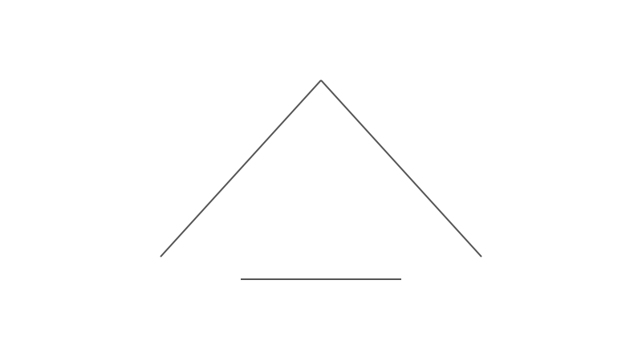

# Kali & Metasploitable Homelab

**A personal homelab**

 

## About Me

I am a **Cybersecurity student** interested in computers, cyber forensics, networking, automation, data, and infrastructure. 

This is a self-contained penetration test lab running Kali Linux and Metaspolitable 2 inside of VMware Workstation. The lab is isolated from my home network and the internet except for a controlled NAT path used by Kali for updates and tool downloads.

This is a personal learning environment built around low-cost options. This project will focus around penetration testing an intentionally vulnerable target to expose vulnerabilities without publishing private information.

## Table of Contents

### Before We Start
- [Hardware & Software](#hardware--software-used)
- [Network Architecture](#network-architecture)
- [Contact](#contact)

### Chapter 1:[Reconnaissance](./Reconnaissance.md)
### Chapter 2:[Exploitation](./Exploitation.md) 

## Hardware & Software Used

| Component | Specified |
|------|-------------|
| CPU | AMD Ryzen 5800X |
| RAM | 32 GB DDR4 @ 3600 MT/s CL 16 |
| Storage | 1 TB NVMe SSD |
| Hypervisor | VMware Workstation Pro 26.0.1.25688693 |

- [Kali Linux](https://www.kali.org/)
- [Metasploitable 2](https://docs.rapid7.com/metasploit/metasploitable-2/)
- [VMware Workstation Pro](https://www.vmware.com/products/desktop-hypervisor/workstation-and-fusion)

## Network Architecture

This is a **simple network diagram**. 

## Contact
Contact me [here](https://onlyredx.github.io/chaves/contact-form)
